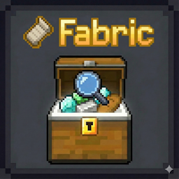

# Basic Chest Search

**Basic Chest Search** is a client-side utility mod for Minecraft that adds a powerful search bar to container interfaces. It helps you locate items instantly in large storage systems like double chests or shulker boxes.

## 🚀 Key Features

* **Search Logic:**
    * **Item Names:** Search by the display name of any item.
    * **Tag Support:** Use the `#` prefix to search for specific item tags (e.g., `#logs`).
    * **Enchantment Search:** Find items by their enchantment names or levels.
    * **Recursive Contents:** Automatically scans inside **Bundles** and **Nested Containers** (like Shulker Boxes).

## ⌨️ Controls

* **Toggle Search Bar:** Press **`T`** (default key) to show or hide the search bar.
* **Quick Action:** Double-click the search bar to clear your current input.

## ⚙️ Configuration

Customize the mod's behavior through the settings menu (requires **Cloth Config**):
* **Mode:** Switch between `SORT`, `DARKEN`, `DISABLED`. (default SORT)
* **Keep-Search:** Keep your search text active after closing the container. (default on)
* **Auto-Focus:** Automatically focuses the search bar when opening a container. (default off)
* **Detach-bar:** Detaches the search bar from the inventory window. (default on)
* **Focus / Clear:** Ctrl+F focuses the search bar, Ctrl+D clears it.
* **Dim opacity:** How strongly `DARKEN` covers non-matching items. (default 50%)
* **Highlight:** Border colour, opacity, and thickness around matches in `DARKEN`. (default yellow, 100%, 1px)

## 📦 Requirements

* **Fabric Loader:** >= 0.20.1
* **Java:** 25
* **Minecraft:** 26.3
* **Dependencies:** [Fabric API](https://modrinth.com/mod/fabric-api)
* **Optional:** [Cloth Config](https://modrinth.com/mod/cloth-config) & [ModMenu](https://modrinth.com/mod/modmenu) (for settings)

## 👤 Author

* **Merphyx**

## 📜 Credits

* **CGCM**

## 📄 License

This project is licensed under the **MIT License**.
